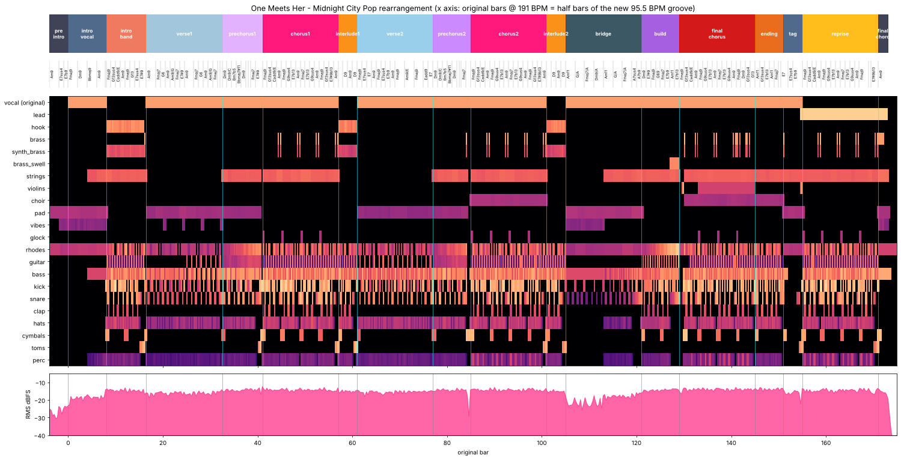

# One Meets Her —— Midnight City Pop 重编曲版

> 把一首 191 BPM 的日系流行朋克，改编成 95.5 BPM 半速律动的**深夜城市流行（City Pop）**。
> 原唱人声**一个音都没有改动**（不变速、不变调），其余所有声部重新编写、重新配和声、重新制作。



*总览图：顶部为段落，第二行为重配后的和弦，中间为 22 个声部的活动热图，底部为成品的响度曲线。横轴是原曲小节号（191 BPM），两个原曲小节 = 新律动的一个小节。*

---

## 1. 原曲分析

所有结论都来自对 5 条分轨的测量：鼓起音点线性回归求速度和相位、按小节折叠的鼓型分析、色度调性分析、basic-pitch 复音转谱（吉他、贝斯）、pYIN 单音音高追踪（人声、贝斯），以及 Whisper 歌词识别（只用来定位段落）。

| 项目 | 结果 |
|---|---|
| 速度 | **191.016 BPM**（对鼓分轨 811 个起音点做线性回归，全曲漂移 < 0.5 ms，原曲是跟节拍器录的） |
| 调性 | **A 小调**（Krumhansl 调性相关 0.858，第二名 A 大调只有 0.596），标准音 A440 |
| 编制 | 主唱 + 左右声像双轨节奏吉他 + 贝斯 + 鼓（`other` 分轨几乎全空，约 -95 dB） |
| 律动 | 流行朋克 backbeat：底鼓在 1、3 拍和第 3 拍后半拍，军鼓在 2、4 拍；和弦常**提前一个八分音符**切入 |
| 不规则小节 | 前奏乐队段多一个 2/4 小节（两段主歌歌词行起点在小节内的位置完全吻合，证明主歌 1 从第 16.5 小节开始）；导歌 1 末尾有 2 拍停顿把相位拉回来 |
| 语言 / 演唱 | 日语女声，音域约 G3–E5；前奏是用副歌旋律做的"冷开场" |

原曲曲式（原曲时间）：

| 段落 | 原曲小节 | 原曲时间 | 原和声 |
|---|---|---|---|
| 人声前奏 | 0–8 | 0:00 | 吉他开放和弦 Cadd9 / Am7 / Em7 |
| 乐队前奏 | 8–16.5 | 0:10 | A 持续音上的小调五声 riff |
| 主歌 1 | 16.5–32.5 | 0:21 | Am ↔ G（每 2 小节），无贝斯 |
| 导歌 1 | 32.5–41 | 0:41 | D 小调贝斯 riff ×4 → D – E – F – E → 停 2 拍 |
| 副歌 1 | 41–57 | 0:52 | F G G Am ×2 → F E G Am → F G G Am |
| 间奏 | 57–61 | 1:12 | A riff |
| 主歌 2 | 61–77 | 1:17 | F△7♯11 ↔ E7sus4，然后 F ↔ Am/E |
| 导歌 2 / 副歌 2 | 77–101 | 1:37 | 同上（导歌 2 最后一小节 F 上停顿） |
| 间奏 / 桥段 | 101–121 | 2:07 | 20 小节 A 持续低音 |
| 爬升 | 121–129 | 2:32 | Dm – E – F – G – F – E – Am – A |
| 终段副歌 + 结尾 | 129–155 | 2:42 | 副歌 + 扩展（最高音 C5）→ 人声在吉他上收尾 |
| 尾奏 | 155–160 | 3:15 | 乐队 riff + 结束和弦 |

## 2. 编曲构思

**为什么是 City Pop？**

1. **律动可以无缝转换。** 191 BPM 的八分音符，正好是 95.5 BPM 的十六分音符。原曲的冲劲没有丢，而是变成了 City Pop 里那种十六分音符的踩镲和八度贝斯，人声的咬字节奏跟新律动天然契合。
2. **人声可以完全保留。** 半速律动不需要对人声做任何时间拉伸，避免了变速带来的音质损伤。
3. **日语女声 + 小调 + 自我认同的歌词**（"私の中の私"、"輪郭なんてなくせない"），很适合 City Pop 那种霓虹灯下、深夜独处的内省情绪。
4. **和声有足够的改造空间。** 原曲是强力和弦，三音往往不明确，正好可以重新配上爵士和声。

**几处主要的编曲设计**

- **副歌改成"王道进行"**（J-Pop 最经典的 IV△7 – V – iii – vi）：`F△9 – G13sus4 – Cadd9/E – Am9`。低音保留原曲 F–G–(E)–A 的走向，上方换成大九、十三挂四和弦。第三小节本来想用 Em7，但旋律在那里唱 C（Em7 的 ♭13 避免音），所以改成以 E 为低音的 Cadd9/E。
- **导歌改成 line cliché**：原曲 D 小调贝斯 riff 换成半音下行低音 `Dm9 – Dm9/C – Bm7♭5 – B♭△7♯11`，旋律在 A 上来回摆动，下方和声一点点往下沉。
- **把属和弦全部换成变化属和弦**：原曲里的 E 大三和弦（和声小调）根据旋律变成 `E7♭13`（旋律唱 C）、`E7♯9`（旋律唱 G）、`E7♭9`（旋律唱 F）。G♯ 只出现在旋律本身唱 G♯ 的地方。
- **铜管 Hook 致敬原曲**：前奏和间奏的铜管旋律用了原曲贝斯 riff 里的半音 **G–G♯–A** 动机；切分节奏来自原曲前奏吉他 riff 的 **3+3+2**（16 分位置 0、6、10）。
- **新增 2 小节 Rhodes 前奏**：原曲人声在 0.6 秒就进来了，新版先用 5 秒的 Rhodes + 黑胶底噪交代"深夜"的氛围。
- **桥段改成 breakdown**：前 8 小节只剩"心跳"底鼓、边击、A 持续低音、Rhodes 震音和 Pad，上方和声在 A 持续音上变化（`Am11 – G/A – F△7/A – Dm9/A`），最后用 `A7sus4 – A7♭9` 推向爬升段的 Dm9。
- **终段副歌"抽空再砸进"**：爬升段的军鼓滚奏在第 129 小节突然消失，只留 Rhodes 托着人声唱"ねえ、その心を…"，一小节后弦乐快速上行音阶 + 军鼓弱起，乐队在第 3 拍重新进入。
- **尾奏扩展成器乐副歌重现**：原曲 4 小节的尾奏延长为 16 小节，合成器 Lead 把副歌旋律从头"唱"一遍（从原唱旋律提取，吸附到调内音并连奏化）。这呼应了歌词里"私の中の私"——另一个自己在回唱。最后落在 Am9 上，Lead 停在 E5。

## 3. 和声重配（原 → 新）

| 段落 | 原曲 | 新编曲 |
|---|---|---|
| 新增前奏 | — | `Am9` · `E7sus4` · `E7♭9` |
| 人声前奏 | Cadd9 / Am7 / Em7 | `F△9` · `Dm9` · `B♭△9` · `Am9` → `E7♯9` |
| 乐队前奏 | A 持续音 riff | `F△9 G13sus4` · `Cadd9/E Am9` · `F△9 G13` · `E7sus4 E7♯9`（2/4 停顿） |
| 主歌 1 | Am · G | `Am9` · `F△7 G6` · `Am9 Am9/G` · `F△7 E7♯9`（两遍，结尾 `E7sus4 E7`） |
| 导歌 | Dm riff · D · E · F · E | `Dm9` · `Dm9/C` · `Bm7♭5` · `B♭△7♯11` · `Dm9` · `E7sus4 E7` · `F△7` · `E7♯9`（导歌 2 结尾 `G7` 停） |
| 副歌 | F G G Am / F G G Am / F E G Am / F G G Am | `F△9 G13sus4 Cadd9/E Am9` / `F△9 G9sus4 E7♭13 Am9` / `F△7 E7♭13 G9sus4 Am9` / `F△9 G13sus4 E7(♯9♭13) Am9` |
| 间奏 | A riff | `Am9 D9 Am9 D9`（多利亚 vamp） |
| 主歌 2 | F△7♯11 ↔ E7sus4，F ↔ Am/E | `F△9 E7sus4 E7 Am9 F△9 E7sus4 E7♭9 Am9` · `F△9` · `Am9/E` · `F△9` · `Eadd9 E7` |
| 桥段 | A 持续音 | `Am11` · `G/A` · `F△7/A` · `Dm9/A` · `Am11` · `G/A` · `F△7/A` · `A7sus4 A7♭9` |
| 爬升 | Dm E F G F E Am A | `Dm9 E7♯9 F△9 G6/9 F△7 E7♭9 Am11 E7♭13` |
| 终段副歌高潮 | F F G G | `F△9 Dm9 G13sus4 G13`（旋律 C5 长音在 sus4 上，再解决到 B） |
| 结尾 | Am G E Am F G-E | `Am11 G13sus4 E7♭13 Am11 F△7 G6–E7`（贝斯 A–G♯–F♯–E 下行） |
| 人声尾句 | （吉他） | `E7` · `E7sus4` · `E7♭9`（只有 Rhodes 和弦乐） |
| 重现段 / 终和弦 | A riff | 副歌和声 · `E7sus4 E7(♯9♭13)` · `Am9` |

## 4. 段落编排（新版时间）

| 时间 | 段落 | 编排 |
|---|---|---|
| 0:00 | 新增前奏 | Rhodes 独奏、颤音琴、黑胶底噪，反向镲把人声引进来 |
| 0:05 | 人声前奏 | Rhodes 延音和弦 + Warm Pad + 颤音琴琶音；第 4 小节起加入弦乐、贝斯和逐渐变大的沙锤 |
| 0:15 | 乐队前奏 | Disco/Boogie 律动（四四拍底鼓 + 反拍开镲）、八度贝斯、Funk 吉他切音、铜管 Hook，最后 2/4 小节齐奏停顿 |
| 0:26 | 主歌 1 | 收着：鼓用边击，前半段贝斯只弹长音，颤音琴在乐句空隙里"回应"人声，后半段吉他反拍切音加入 |
| 0:46 | 导歌 1 | line cliché 低音 + 吉他分解和弦 + 弦乐渐强 + Rhodes 八分音符脉动，军鼓滚奏 → 齐奏停顿 |
| 0:57 | 副歌 1 | 全编制：Rhodes 切分、Funk 切音、弦乐铺底、乐句末铜管"嗒—嗒"、钟琴点缀 |
| 1:17 | 间奏 | 铜管 Hook 回归（多利亚 vamp） |
| 1:22 | 主歌 2 | 比主歌 1 更满：完整军鼓、十六分踩镲、贝斯律动、吉他切音 |
| 1:42 | 导歌 2 | 同导歌 1，最后在 G7 上停一拍半，人声在空白里唱下行半音 |
| 1:52 | 副歌 2 | 副歌 1 + Voice Oohs 和声 + 铃鼓 |
| 2:12 | 间奏 2 | 铜管 Hook，嗵鼓过门进入桥段 |
| 2:17 | 桥段 | breakdown：心跳底鼓 + A 持续低音 + Rhodes 震音；后半段鼓、贝斯、弦乐逐渐回来，上升音效 |
| 2:37 | 爬升 | 四四拍底鼓、铜管渐强、十六分军鼓滚奏 → 突然全停 |
| 2:47 | 终段副歌 | 第一小节只有 Rhodes + 人声 → 弦乐上行音阶 + 军鼓弱起 → 乐队第 3 拍砸进；小提琴八度对位旋律、合唱、铃鼓 |
| 3:08 | 结尾 | 贝斯 A–G♯–F♯–E 下行，齐奏停 |
| 3:15 | 人声尾句 | Rhodes + 弦乐托住人声长音，黑胶底噪回来 |
| 3:20 | 器乐重现 | 合成器 Lead 唱副歌旋律（八度叠加、延迟颤音、滑音、附点八分延迟），全乐队 |
| 3:40 | 终和弦 | Am9 + Lead 的 E5 长音，颤音琴琶音收尾，约 3:47 结束 |

## 5. 制作

**声部生成（`src/parts.py`）**：所有声部由代码生成 MIDI，按 16 步网格写律动型（新律动的 1 步 = 原曲的 1 个八分音符）。

- 和弦排列用一个自动声部进行算法：在每个乐器的音区里枚举排列，最小化相邻和弦之间的声部移动，并惩罚小二度和低音区密集音簇。Rhodes 用无根音排列（大七和弦排成 3-5-7-9，避免根音和旋律的大七度形成小二度摩擦），吉他用上方三和弦（例如 F△9 上弹 Am 三和弦），弦乐用"高音区小提琴 + 大提琴导音"，让出人声所在的 C4–C5 音区。
- 人性化：时间抖动（鼓 ±2–4 ms，Rhodes 稍微拖后约 7 ms）、力度随机、扫弦按弦序错开。Rhodes 和吉他会在下一个和弦前的十六分音符"提前切入"（push）。

**音源**：FluidSynth + MuseScore General 音色库（Tine EP、Funk Guitar、Fingered Bass、Strings Slow Expr（用 CC2 控制力度）、Violins Fast、Brass Section、Synth Brass、Warm Pad、Voice Oohs、Vibraphone、Glockenspiel、Room 鼓组）。另外自己写了几个合成器（`src/synth.py`）：底鼓低频层、Lead（双振荡器 PolyBLEP 锯齿 + 方波、滑音、延迟颤音、滤波包络）、反向镲、上升音效、冲击低音、黑胶底噪，以及按频段设定衰减时间的合成板式 / 房间混响。

**人声处理**：高通 95 Hz → -2 dB @ 320 Hz → -2.5 dB @ 660 Hz（主歌反复唱 A3/E4，泛音堆在这里）→ 3:1 压缩 → +2 dB @ 3 kHz → -2.5 dB @ 9.5 kHz + 5–11 kHz 动态去齿音（AI 分离人声特有的高频嘶声）→ 板式混响 + 附点八分音符延迟（0.471 s）。

**混音与母带**：每个声部按目标响度（LUFS）自动定电平；主歌段落自动拉低鼓和吉他；2–4 kHz 给人声让位（吉他 -2.5 dB @ 2.6 kHz，弦乐 -2 dB @ 3 kHz）；段落级宏观动态（主歌 -1.5 dB、桥段 -2 dB、终段副歌 +0.5 dB）→ 总线压缩 → 自己写的 4 倍过采样前瞻真峰值限幅器。

## 6. 客观验证

我听不到声音，所以每一步都用测量来检查：

| 检查项 | 结果 |
|---|---|
| 旋律音在伴奏里的平均和声支持度（色度谱） | **新版 0.634**，原曲 0.587 |
| 旋律与和弦冲突检查（≥0.45 拍的避免音 / 非和弦音） | 剩余的都是滑音经过音、提前进入的弱起，或者 E 唱在 F 低音上（大七和弦本来的音程），没有真正的冲突 |
| 副歌 2–4 kHz 人声比伴奏高 | +3.3 dB（第一版是 -0.1 dB，经过 EQ 让位后改善） |
| 主歌 / 副歌伴奏响度差 | 4.2 dB（第一版 2.6 dB） |
| 母带 | WAV -11.96 LUFS / -1.6 dBTP；MP3 解码后 -11.9 LUFS / -1.2 dBTP；LRA 4.1 LU |
| 时长 | 3:47 |

迭代中发现并修掉的问题：MuseScore 的 Expr 弦乐预设用的是 CC2 而不是 CC11（第一版弦乐几乎无声）；pedalboard 自带的 Limiter 会让真峰值超过 0 dBTP（改为自写限幅器）；黑胶噼啪声的峰值太大（前奏峰值因数 23 dB，已降低约 30 dB）；弦乐和合唱原本压在人声音区（已重新排列）；尾奏 Lead 从人声直接提取时音符碎、带滑音半音（改为吸附到调内音并连奏化）。

## 7. 如何重新生成

需要原曲的 5 条分轨（文件名 `01_one_meets_her_bass.wav` … `05_one_meets_her_guitar.wav`；最终混音只用到 `04_one_meets_her_vocals.wav`）。

```bash
sudo apt-get install fluidsynth musescore-general-soundfont lame
pip install -r requirements.txt
cd src
python3 build.py --stems /path/to/one_meets_her_stems --out ../output
python3 plot_arrangement.py ../docs/arrangement_map.png ../output/one_meets_her_midnight_city_pop.wav
```

4 核 CPU 大约 4 分钟。输出：

- `one_meets_her_midnight_city_pop.wav / .mp3`：完整混音
- `one_meets_her_midnight_city_pop_instrumental.wav / .mp3`：伴奏版
- `stems/*.flac`：分组分轨（鼓、贝斯、键盘、吉他、弦乐、铜管、Pad、Lead、音效、混响返回、人声）
- `midi/one_meets_her_city_pop_arrangement.mid`：全部新声部的多轨 MIDI（95.508 BPM，带 5/4 拍号变化和段落标记，tick 0 对应音频 0.346 秒）
- `render_report.json`：响度、真峰值、时长、原唱偏移量（5.0258 秒）

所有编曲数据都在代码里：改和弦就改 `src/chords.py` 的 `CHART`，改律动就改 `src/parts.py` 里的 pattern，改混音就改 `src/render.py` 的 `CHAINS`，然后重新运行 `build.py`。

## 8. 代码结构

| 文件 | 内容 |
|---|---|
| `src/timeline.py` | 原曲速度网格（191.016 BPM，相位 0.032 s）和新编曲的时间映射 |
| `src/chords.py` | 和弦词汇（和弦音 / 可用延伸音 / 避免音 / 键盘排列 / 吉他上方三和弦）、重配和弦谱、段落表 |
| `src/parts.py` | 鼓、贝斯、Rhodes、吉他、弦乐、Pad、合唱、铜管、Mallets、Lead 的生成器和声部进行算法 |
| `src/synth.py` | 自制合成器、音效和混响脉冲响应 |
| `src/render.py` | MIDI → FluidSynth 渲染、效果链、人声处理、混音、母带、真峰值限幅器 |
| `src/analysis.py` | pYIN 人声旋律提取（用于尾奏 Lead） |
| `src/build.py` | 一键构建入口 |
| `src/plot_arrangement.py` | 编曲总览图 |
| `midi/` | 新编曲的多轨 MIDI（不含从原唱转录的 Lead 轨） |
| `docs/arrangement_map.png` | 编曲总览图 |

## 关于版权

这个仓库是公开的。完整混音用到的是原唱人声分轨（从商业录音中 AI 分离出来的），属于受版权保护的录音，所以**仓库里没有提交任何包含原曲录音的音频**，成品音频是单独交付的。尾奏 Lead 的旋律是从原唱转录的，所以仓库里的 MIDI 也去掉了这一轨（`build.py` 会在本地输出目录里生成含 Lead 的完整 MIDI）。如果你拥有这首歌的相关权利，可以自行把 `output/` 里的音频加进来。
